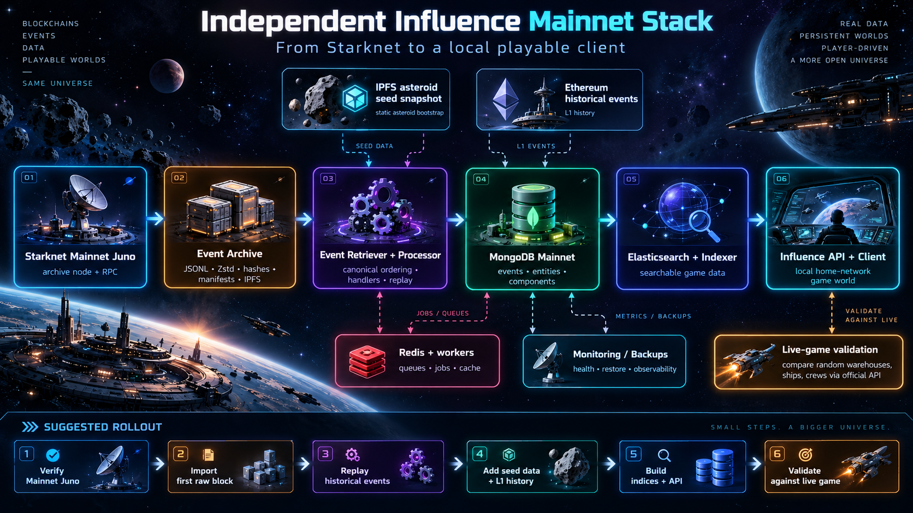

# Influence Event Archive (experimental)

Tools for rebuilding and independently verifying Influence blockchain event archives, starting with Starknet Sepolia and Mainnet.

## Verified so far (2026-10-16)

- A local Juno v0.16.7 node serves Sepolia JSON-RPC at `http://127.0.0.1:6060/v0_10`.
- Historical `starknet_getEvents` queries work, including continuation-token pagination.
- The Sepolia Dispatcher range 60,000–70,000 returned 355,422 events in the user's test.
- The resulting test dataset (~214 MiB JSONL) compressed to ~14.5 MiB with zstd -3 and ~9.07 MiB with zstd -19.
- In block 70,000, the raw event associated with transaction `0x2fc7fb03c906e358b11a891527270306c41353a1891853b29b5ad5b2c70066a` matched the `ComponentUpdated_Inventory` record in MongoDB (keys and data).
- The working Testnet MongoDB database is named `pre-release`; **do not modify it**.

These tests do not establish complete event coverage or prove that all game state can be rebuilt.

## Mainnet bootstrap field notes

- [2026-10-17: Mainnet Juno snapshot, disk usage, first RPC/event import and worker configuration](MAINNET-BOOTSTRAP-2026-10-17.md) — measured storage baseline, tested commands, and next steps. Treat as a dated experiment, not a complete Mainnet rebuild.

## Files

- `download_events.py`: standalone Python 3 downloader. Resumes by completed block-range file; supports pagination and retry. No dependencies beyond the standard library.
- `verify_block.py`: compare *all* archive events for a specified block/contract with records in the existing MongoDB database (read-only).
- `verify_range.py`: stream the MongoDB cursor and compare all archive events in a block range, one archive file at a time (read-only).
- `.gitignore`: excludes archives, credentials, snapshots and local outputs.

## Download sample (Sepolia)

```sh
export STARKNET_RPC_URL=http://127.0.0.1:6060/v0_10
python3 download_events.py --network sepolia --contract dispatcher --start 70000 --end 70000 --out events-testnet
```

For Mainnet set `--network mainnet`, and set `STARKNET_RPC_URL` to your Mainnet node's endpoint. **Do not store private RPC API URLs or secrets in the repository.** The tool refuses to silently reuse an existing output file with a different recorded query identity. Event files are written atomically with a sidecar metadata file.

## Verify a block against the existing Testnet MongoDB

```sh
python3 verify_block.py --file events-testnet/sepolia_dispatcher_70000_70000.jsonl --block 70000
```

Defaults: Mongo container `mongodb`, database `pre-release`. Requires `mongosh` inside the container and the container's `MONGO_INITDB_ROOT_USERNAME` / `MONGO_INITDB_ROOT_PASSWORD` environment variables. This is strictly read-only.

The verification compares event occurrence counts after normalizing numeric hexadecimal fields. MongoDB may retain a different subset of events or processing metadata; mismatches require investigation. Chain RPC is the primary source for completeness verification, not MongoDB alone.

## Verify the historical sample (60,000–70,000)

Using the original local downloader filenames (which were named `asteroid_...` although the source was the Sepolia Dispatcher):

```sh
python3 verify_range.py --dir ../../events-testnet --start 60000 --end 70000
```

Run this from the `event-archive` directory inside the cloned repository, or pass the correct absolute path via `--dir`. Files are checked for contiguous coverage. The script compares hexadecimal-normalized transaction, contract, key and data fields, counting duplicate event occurrences. It reports discrepancies and returns a nonzero exit code when events differ. The script assumes the downloaded block files come from the specified contract and MongoDB is synchronized through the range; it does **not** prove independent blockchain completeness.


## Diagnose a specific discrepancy without modifying MongoDB

The 60,000–70,000 Sepolia Dispatcher comparison returned 355,422 archived events and 352,533 MongoDB events, with 3,886 archive occurrences missing from MongoDB and 997 extra MongoDB occurrences. The overlap was 351,536 matching occurrences. A preliminary investigation of block 66,961, transaction `0x00ce3d3ac1868cbfc87e90be3028687a72c8a03b7449863764cbce46c20cdd0a` showed 10 canonical Dispatcher receipt events but 18 MongoDB Dispatcher records, with two insertion timestamps (2026-10-10 and 2026-10-11 UTC). MongoDB block hash matched Juno. Do **not** conclude that all differences are duplicates: the missing archive events also require investigation.

From `~/Influence-Mainnet`:

```sh
python3 influence-helper/event-archive/diagnose_transaction.py \\
  --file events-testnet/asteroid_66000_66999.jsonl \\
  --block 66961 \\
  --tx 0x00ce3d3ac1868cbfc87e90be3028687a72c8a03b7449863764cbce46c20cdd0a
```

The diagnostic uses the normalized transaction and contract addresses, compares multiplicities of keys/data, groups records by creation timestamp, and reports statuses and block hashes. It is read-only. A nonzero exit status means the MongoDB event multiset differs from the archive.

**Decision rule:** event differences alone are not enough to recommend rebuilding the game state. First establish whether differences affect finalized canonical events, whether the event processor is idempotent, and whether derived component/entity state is wrong. Compare regenerated state in an isolated database against the current instance before choosing a destructive rebuild; never rebuild the working database as a diagnostic.


## Mainnet chunk builder — portable/IPFS-ready experiment (2026-10-17)

`build_mainnet_chunks.py` writes immutable, content-verifiable **raw Starknet event chunks** split by inclusive block range. Each chunk contains `events.jsonl` (or compressed `events.jsonl.zst`) and `manifest.json` with chain ID, block range, source contract addresses, start/end block hashes, event count and SHA-256 hash. It queries **seven tracked Mainnet contracts**, handles RPC pagination and requires canonical `transaction_index`/`event_index` metadata. Existing chunks are verified before skipping; partial or inconsistent output is not overwritten.

First small experiment (requires running Mainnet Juno RPC on 6061; read-only against Juno, no MongoDB changes):

```sh
cd ~/Influence-Mainnet/influence-helper
git pull
cd event-archive
python3 build_mainnet_chunks.py --rpc http://127.0.0.1:6061/v0_10 \\
  --start 218425 --end 218449 --step 25 --compress \\
  --out ~/Influence-Mainnet/mainnet-chunks
python3 build_mainnet_chunks.py --verify-only \\
  --out ~/Influence-Mainnet/mainnet-chunks
```

Requires installed `zstd` when using `--compress`; otherwise Python standard library is sufficient. The chunk directory naming `blocks_START_END` allows storing files on external media or publishing the *complete directory* through IPFS later. **The script does not upload to IPFS or build an Influence MongoDB.** IPFS CIDs and a signed root catalog are future features; SHA-256 verifies bytes but does not authenticate the publisher. A future replayer should consume a validated manifest catalog in order, decode event types through the correct handler version, add static IPFS asteroid data / Ethereum historical state, and build the application's MongoDB collections and indices.

**Scope limitations:** only the seven tracked Mainnet contracts and their raw Starknet events; other contracts and Ethereum events may be required for full reconstruction. Chunk boundary hashes provide basic reorg detection, not complete per-block verification or consensus proof. Before scaling to millions of blocks, benchmark Juno event-query limits, memory usage and compression; define exact canonical indexing, chain-finality policy, and disk budgets. Start with small bounded chunks; do not attempt the full historical sweep in one run.

## Mainnet first-block smoke test (isolated lab, NOT a playable database)

`mainnet_first_block.py` is a cautious first-block experiment: it verifies SN_MAIN and the requested block hash, queries seven known Mainnet Influence contract addresses with pagination, writes JSONL plus a SHA-256 manifest, and can optionally import the **raw** records into a new MongoDB container that is isolated with `--network none`. It does not use or change the existing Testnet `mongodb` container, `pre-release` database, or Influence server.

Run after the local Juno Mainnet archive has been extracted and the Mainnet RPC endpoint is operational:

```sh
cd ~/Influence-Mainnet
python3 influence-helper/event-archive/mainnet_first_block.py \\
  --rpc http://127.0.0.1:6061/v0_10 --block 218425
```

**The example port 6061 is not configured by the script**; replace it with your actual separate Mainnet RPC endpoint. The default run downloads the first block's events but does not touch MongoDB. After reviewing output, optionally add `--import-mongo` on a fresh run with a new `--output` directory to create the isolated container `influence-mainnet-lab-mongo`, Docker volume `influence-mainnet-lab-mongo-data`, and database `influence_mainnet_lab`. The script refuses to overwrite existing archives or reuse an existing named lab container. MongoDB is network-disabled and is accessible only through `docker exec`. If the first block has zero events, the script does not create the lab; test the next relevant block rather than inventing seeded events.

**Not yet implemented:** replay with the upstream handler pipeline, component migrations, IPFS asteroid seed snapshots, Ethereum events, Elasticsearch/indexer, production bootstrap checkpoints, and live-game API validation. The first-block smoke test proves only the raw event acquisition/import path. The full build must start with the upstream mainnet environment/config in completely separate services/volumes and enforce stable canonical transaction/event indices.

### Intended stack and execution order

```text
Mainnet Juno (archive, fully synced)
    |
    +-- Starknet raw events (+ Ethereum L1 events, separate historical source)
    |     |
    |     +-- versioned JSONL / Zstd / hashes / block attestations / IPFS
    |               |
    +--------------> replay + event handlers --> isolated MongoDB (events, entities, components)
                                                   |
IPFS asteroid seed snapshot -----------------------+
                                                   |
                                            ElasticSearch indexer
                                                   |
                                             API server / client
                                                   |
                                        Compare random warehouses with live API
```

Suggested stages: (1) verify snapshot/extraction and Mainnet RPC; (2) read the origin block into isolated raw MongoDB; (3) integrate the real Influence event retriever and processor against dedicated Mainnet services; (4) bootstrap IPFS-sourced static asteroid data and Ethereum historical events; (5) index Elasticsearch and expose API/client; (6) compare actual inventories/components to live Mainnet. **Never use an existing Testnet MongoDB volume for an experiment.**


## Architecture Overview

<p align="center">
  
</p>

<p align="center"><em>
Concept infographic for the long-term goal: from Starknet Mainnet data to a locally playable Influence client.
Fun placeholder for now — we can replace it later with a cleaner technical diagram.
</em></p>

## Roadmap

1. Verify entire blocks/ranges against independent RPC sources, including empty blocks and complete pagination.
2. Create versioned manifests with chain ID, contract list, range, block hash, SHA-256 and optional IPFS CID.
3. Define deterministic event ordering and finalized-range policy (reorgs).
4. Audit Ethereum events and off-chain / seeded state dependencies.
5. Replay into a disposable database; never replay directly into the working Testnet database.

**Important:** Our local Juno v0.16.8 Mainnet RPC **does supply** `transaction_index` and `event_index` in `starknet_getEvents` results (verified 2026-10-17). Preserve these indices; other RPC providers/versions may differ. Full deterministic replay still requires consistent ordering, handler filtering, and historical state initialization.
