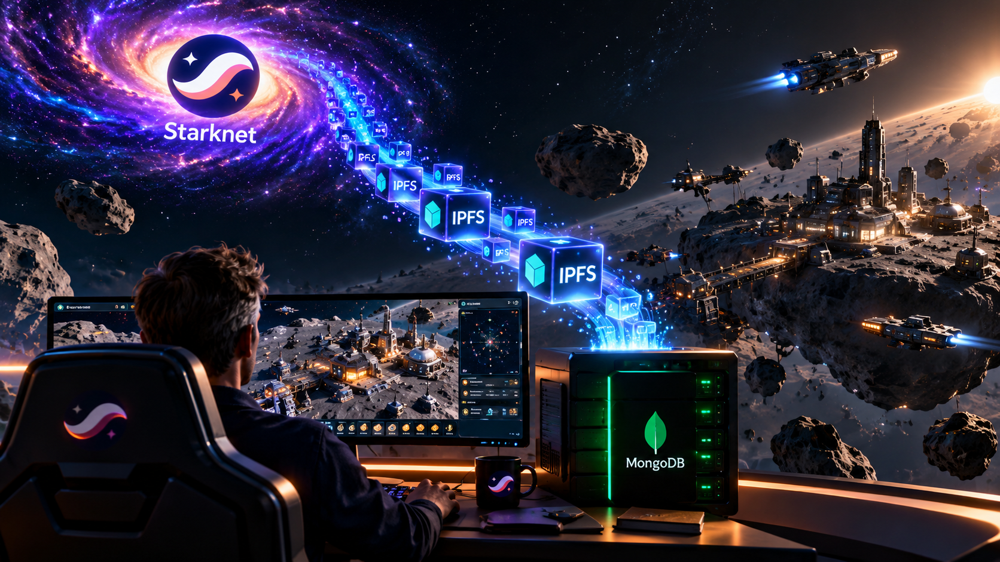

# Influence Mainnet reconstruction

An independent, reproducible pipeline from **Starknet Mainnet events** to a locally reconstructed **Influence MongoDB**. Work remains divided into two complementary stages.



| Stage | Goal | Current status |
|---|---|---|
| [1. Starknet → IPFS](1_Starknet-IPFS/README.md) | Collect, verify and eventually publish self-contained event chunks | Local downloader V1 and archive verification tested; deterministic IPFS publication still planned |
| [2. IPFS → MongoDB](2_IPFS-MongoDB/README.md) | Recover Influence game state using original handlers, safe checkpoints and independently replayable history | **V12 active local prototype**: completed through block **299,999**; next 100,000-block interval under test |

## What changed in V12?

Our **vision has not changed**. We still want to build an independently reproducible Mainnet game state from open, verifiable historical sources.

To validate the reconstruction engine before finishing IPFS packaging, **V12 currently reads Mainnet events directly from a local Juno node**. This temporary implementation uses:

```text
Local Juno -> retrieve -> MongoDB events
                        -> validated historical exceptions (if needed)
                        -> drain through original Influence handlers
                        -> dedicated MongoDB snapshot + checksum + progress
```

The source asteroid universe is bootstrapped from the official 250,000-asteroid dataset. V12 uses isolated Docker infrastructure and 100,000-block recovery intervals. Historical event compatibility exceptions are documented per interval and applied to decoded fields only; the underlying blockchain event data is preserved.

The last **confirmed completed V12 checkpoint** is block **299,999**. Interval 300,000–399,999 has been under active test; no completion claim is made here. See the [V12 design and exception workflow](2_IPFS-MongoDB/V12-PROTOTYPE.md) for implementation details, tests, commands and open issues.

## Source archives and local-only data

On `bahn`, the earlier event archive lives in `/home/iu/Influence-Mainnet/mainnet-chunks/`. At the documented 2026-10-30 milestone, all **1,482** aligned 1,000-block chunks from **218000 through 1699999** were physically consolidated; each contains `events.jsonl.zst`, `manifest.json` and `metadata.json`, and all passed local checks. Representative chunks were compared directly against Juno.

The published [Stage 1 downloader](1_Starknet-IPFS/downloader/) and its instructions describe the verified collector. V12's working files, MongoDB state and recovery snapshots reside locally on `bahn` and **must not be mistaken for material already published on GitHub or IPFS**.

## Principles

- Keep the **vision image and independent-reconstruction objective** unchanged.
- Preserve canonical blockchain event order and contract identities.
- Make archived event chunks self-contained and verifiable; ultimately downstream replay should not require a live Starknet RPC node.
- Keep raw chain events unchanged; document and strictly validate any decoded-field compatibility corrections.
- Use isolated databases, fail-closed processing and verified checkpoints for safe recovery.
- Preserve historical V09 and V10/V11 evidence rather than rewriting old results.
- Publish deterministic IPFS packages only after defining their canonical format and verifying independent reproduction.

**Project history:** [dated research and test reports](history/), including the [2026-10-30 archive consolidation](history/2026-10-30_STARKNET-ARCHIVE-CONSOLIDATION.md). Previous code experiments remain in [archive/](archive/).
