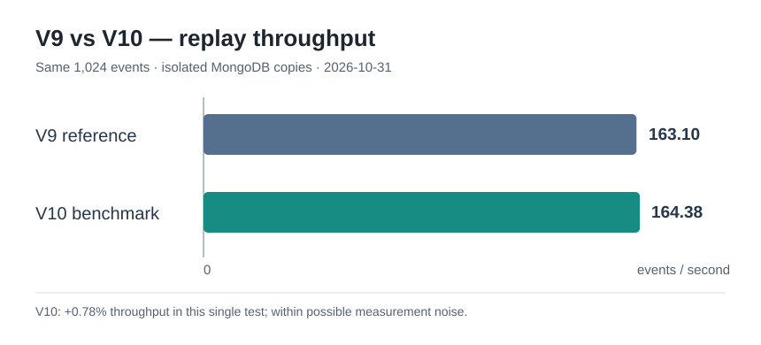
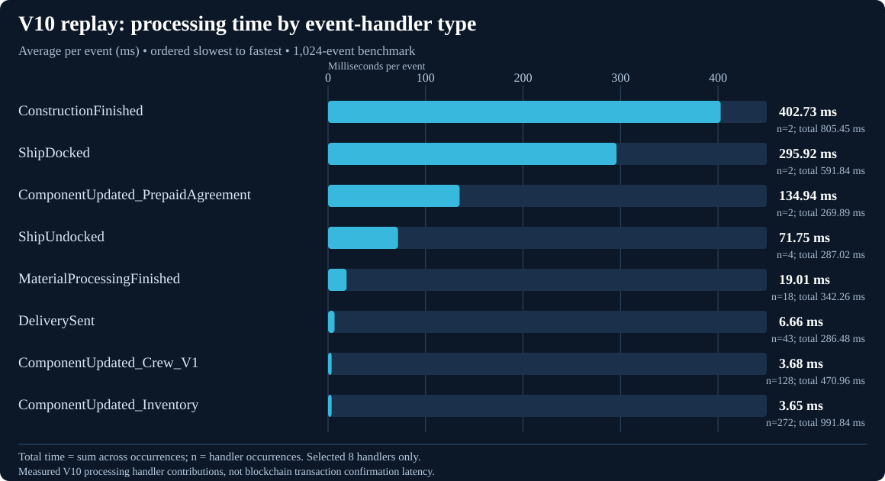

# Influence Mainnet — V9/V10 replay benchmark and correctness audit

**Date:** 2026-10-31  
**Host:** `bahn` (Ubuntu home server)  
**Status:** 1,024 event records verified equal after narrowly scoped timestamp normalization; **full game-state equivalence not yet proven**.

## Executive summary

We tested an experimental V10 replay approach against the existing V9 replay using **the same 1,024 events** from a common V9 snapshot in **two isolated, disposable MongoDB databases**. Both runs completed their 1,024-event replay and finished with zero pending events. Throughput was close: **V9 ~163.1 events/s; V10 ~164.38 events/s**. The ~0.78% difference from a single run is **not evidence of a meaningful speed improvement**.

A first attempt to compare the entire restored state (~29 million documents per database) was stopped after approximately ten minutes because its cost had not been communicated or bounded appropriately. Codex redesigned the correctness checker as a read-only, progress-reporting, resource-limited tool. The final bounded event audit completed in **1.5 seconds**, finding that all 1,024 event records matched once replay-time `lastProcessed` and `updatedAt` fields were explicitly excluded. No event payload or blockchain timestamp fields were excluded.

**Important:** `equivalent: null` in the final report is intentional. This audit validates selected event documents, not all game-state collections.

## Performance comparison



| Metric | V9 reference | V10 benchmark |
| --- | ---: | ---: |
| Events processed | 1,024 | 1,024 |
| Throughput | ~163.1 events/s | 164.37897 events/s |
| Replay time | ~6.28 s inferred from rounded throughput | 6,229.51 ms measured |
| Pending events after replay | 0 | 0 |
| Events collection count | 12,047,896 | 12,047,896 |

V10 instrumented breakdown: processing **5,847.06 ms**; finalization **369.94 ms**. Timings shown here reflect a **single small benchmark** and must not be extrapolated to a ~17-million-block replay.

### V10 average processing time per event-handler type



The chart divides each handler's **measured total time** by its **occurrence count** and includes both values in the labels. It covers **eight selected handler types**, not every event type, and reflects **V10 handler processing contributions**, not blockchain transaction confirmation latency. Rare handlers (for example, `ConstructionFinished` and `ShipDocked` at only two occurrences each) have particularly uncertain averages; results are from one 1,024-event replay.

### V10 handler hotspots (measured total wall-clock contributions)

| Handler | Events | Total time | Notes |
| --- | ---: | ---: | --- |
| `ComponentUpdated_Inventory` | 272 | ~991.84 ms | Largest cumulative contribution |
| `ConstructionFinished` | 2 | ~805.45 ms | ~400.8 ms/event |
| `ShipDocked` | 2 | ~591.84 ms | ~295.9 ms/event |
| `ComponentUpdated_Crew_V1` | 128 | ~470.96 ms | Frequent handler |
| `MaterialProcessingFinished` | 18 | ~342.26 ms | — |
| `ShipUndocked` | 4 | ~287.02 ms | — |
| `DeliverySent` | 43 | ~286.48 ms | — |
| `ComponentUpdated_PrepaidAgreement` | 2 | ~269.89 ms | — |

These timings identify investigation candidates, not independently established bottlenecks.

## Reproducibility and data protection

- Snapshot source: `/home/iu/Influence-Mainnet/v9-checkpoints/v9-block-1697999.archive.gz` (~2.7 GB). SHA-256: `c7714d62ba05bc6e2917749cd6c657db59e40c11efc73beb8ec6803f796f190e`.
- Snapshot contained approximately **29,125,378** documents across **64 collections**, including **12,046,872** already processed events. The final tested databases each contained 12,047,896 events (after adding 1,024).
- Source block archive: `mainnet-chunks/blocks_1698000_1698999/events.jsonl.zst`. Source SHA-256: `adacc79842a6340b282dc672618b2227624e7af0e5c36b63c556f1bf297bf326`. Originally 1,555 raw events, 139 unhandled; validated parsed event list 1,416 (SHA-256 `0953b60512bf66e134347ee8a0a5fb1be21e602c5d4305b8491f97231ec7ee19`).
- Comparison window: **blocks 1,698,005–1,698,715**; exactly **1,024 selected events**.
- Disposable V9 reference: Docker `influence-v10-reference-mongo`, database `influence_mainnet_replay_v9_reference`.
- Disposable V10 candidate: Docker `influence-v10-benchmark-mongo`, database `influence_mainnet_replay_v10`.
- Source code areas (local): `event-archive/v10/benchmark_replay.js`, `event-archive/v10/reference_replay_v9.js`, `event-archive/v10/compare_correctness.py`; documentation `event-archive/v10/README.md`.
- The V10 benchmark used a pinned `influence-server` image digest `sha256:60165ce8266275c07348cc564243fbc13ad7a09dfd32a7328142a5c9715cba1c`. Its one-shot guard is already claimed; **do not rerun the benchmark without restoring the test snapshot and resetting the disposable guard deliberately**.
- The original V9 reconstruction database, final historical backups, and archives **must remain untouched**. No benchmark or comparison instructions should target them.

## Correctness verification

### 1. Initial component check

The full `Component_Inventory` collection contained **66,133 records** on each side. An earlier independent comparison found the same domain values after normalizing generated MongoDB `_id` and linked `event.id` references. This is **supporting evidence only**: it did not independently prove referential integrity or equality of all other collections.

### 2. Bounded event audit

The improved checker defaults to events-only; an expensive full-state run now requires explicit `--strategy full`. Safeguards include fixed target allowlists, read-only operations, a dry-run plan, a quiescence acknowledgement, a document budget, duration budget, disk checks, progress output, process supervision and cancellation cleanup. Index selection was corrected to use the existing `{"__t":1,"blockNumber":-1}` index for Starknet event-range queries. Preflight output is now concise, with `--verbose-indexes` optional.

**Strict event comparison:**
- V9 event records: 1,024; V10 event records: 1,024.
- Missing on either side: **0**.
- 1,024 marked changed. The first 10 examples showed only differing `lastProcessed` and `updatedAt` values; the examples alone did not establish this for all 1,024.

**Normalized comparison:** Run with `--ignore-processing-timestamps`, which ignores **only top-level** `lastProcessed` and `updatedAt` in event strategy; it still compares other timestamps, nested fields and event payloads.

```json
{
  "schema": "v10-correctness-v2",
  "scope": "events",
  "equivalent": null,
  "selectedRecordsEqual": true,
  "differencesRemain": false,
  "ignoredEventFields": ["lastProcessed", "updatedAt"],
  "becameEqualAfterTimestampNormalization": 1024,
  "collections": [{
    "collection": "events",
    "referenceCount": 1024,
    "candidateCount": 1024,
    "equal": 1024,
    "missingReference": 0,
    "missingCandidate": 0,
    "changed": 0
  }]
}
```

**Run result:** exit code **0**, 2,048 event documents read, **~1.5 seconds** elapsed. The latest Codex changes passed **39 offline Python tests**. This is evidence of event-document equality under the stated normalization, **not full state equivalence**.

Reproduce the bounded, read-only comparison **only when both disposable databases are quiescent**:

```bash
cd /home/iu/Influence-Mainnet/influence-helper
python3 event-archive/v10/compare_correctness.py \
  --read-isolated-databases \
  --strategy events \
  --ignore-processing-timestamps \
  --quiescent \
  --max-seconds 60 \
  --max-documents 3000 \
  > /home/iu/Influence-Mainnet/v10-comparison/events-normalized.json
echo "Exit code: $?"
```

### 3. Failure and recovery lessons

1. **Full-history comparison was too expensive for an unannounced first run.** An initial checker streamed roughly 29 million documents per database, staged data to SQLite and was stopped after about ten minutes. The parent and a lingering `mongosh` process had to be terminated separately. No intentional MongoDB writes occurred.
2. **First bounded event run failed safely.** The query used an index hint that did not exist; MongoDB returned a planner error, and the run reached its 60-second limit with exit code 2 and zero documents compared.
3. **Codex corrected index selection and early error propagation.** The subsequent strict comparison finished in ~1.6 seconds but returned exit code 1 because replay-time timestamps differed.
4. **Explicit, narrow normalization resolved the differences.** The final comparison finished in ~1.5 seconds with zero remaining differences and exit code 0.

For future operations: give advance warning and a workload estimate, run a metadata-only preflight, enforce resource bounds, report progress, and handle child-process termination reliably.

## Current limitations and proposed next work

**Next priority: validate game-state changes** in `Component_*`, `entities`, `activities`, `indexitems` and other collections, including creations, edits, removals, secondary index/queue effects and cross-document references.

A fast event-only audit cannot discover all indirect writes or deletions. Preferred design for the **next** V10 benchmark:

1. Capture a reliable **write manifest** during both V9 and V10 replays, including collection, operation type, stable/natural document identity, before/after identity where required, and deletions.
2. Include secondary effects and indirect changes, not only documents tagged with the triggering event.
3. Normalize only explicitly justified nondeterministic fields and generated IDs/references while preserving all game-state semantics.
4. Compare the manifest union and final state of every affected logical document on both sides; verify missing, extra and deleted records. Document any uninstrumented write paths.
5. Add offline regression tests and bounded trial runs before attempting a broader performance comparison.
6. If write coverage cannot be proven, mark the resulting report as **partial**; use an independently audited full snapshot diff for a definitive equivalence claim.

**Do not execute another replay yet.** Preserve the existing disposable benchmark datasets and the protected V9 data. Consider multiple matched, warm-up-aware benchmark samples once state-validation coverage is satisfactory.

## Quick handover

- **What works:** V9 and V10 replayed the same 1,024 events; event documents are equal after excluding only replay-time `lastProcessed` and `updatedAt`; bounded checker returns exit 0 in ~1.5 seconds.
- **What is not proven:** equality of all game-state effects; significant V10 performance advantage.
- **What to do next:** inspect write paths, design and test manifest capture, then perform a new disposable benchmark with comprehensive state-change validation.
- **What to protect:** original V9 mainnet database and final backups; preserve completed isolated V9/V10 benchmark state until deliberately replaced.
